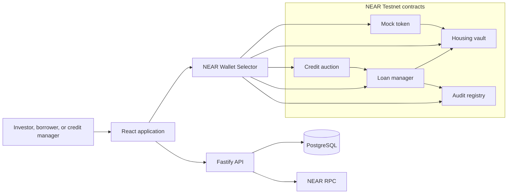

# HOMR

**Housing credit allocation on NEAR Testnet**

HOMR connects stablecoin investors with property borrowers through a shared liquidity vault and a sealed-bid credit auction. Credit documents stay in an offchain review workflow, while approvals, bids, allocations, loans, and repayment records can be verified on NEAR.

> HOMR is a testnet prototype. It uses mock USDC with no monetary value and is not a production lending service.

| Resource | Link |
| --- | --- |
| Live demo | [homr.web.id](https://homr.web.id) |
| Public repository | [github.com/arsenicbreaker/HOMR](https://github.com/arsenicbreaker/HOMR) |
| Network | NEAR Testnet |
| Hackathon tracks | Unstoppable DeFi, Real-World Money |

## The problem

Housing credit combines information that should not be public, such as borrower and property documents, with decisions that benefit from transparency, such as credit limits and capital allocation. Investors also need a clear record of where pooled capital goes and whether loans are repaid.

HOMR separates those responsibilities:

- A credit manager reviews borrower and property information offchain.
- The resulting account approval, property reference, and borrowing limit are recorded onchain.
- Approved borrowers submit sealed commitments and later reveal their loan terms.
- The auction contract selects the valid bid with the highest offered rate.
- The loan manager requests funding from the shared vault and records the resulting loan lifecycle.

## Product flow

### Investor

1. Connect a NEAR Testnet wallet.
2. Claim mock USDC from the testnet faucet.
3. Deposit mock USDC into the Housing Credit Vault.
4. Receive `hvSHARE` vault shares.
5. Monitor available capital and funded loans from the dashboard.

### Borrower

1. Connect a NEAR Testnet wallet and submit a financing application.
2. Wait for a credit manager to review the application offchain.
3. After approval, commit a hashed bid during the commit phase.
4. Reveal the amount, rate, term, and salt during the reveal phase.
5. If selected when the auction is finalized, receive the testnet loan allocation and monitor its status.

### Credit manager

1. Review applications stored in the credit database.
2. Grant an approved account a maximum principal and property reference onchain.
3. Start and finalize auction cycles.
4. Monitor revealed bids, issued loans, and audit events.

## How NEAR is used

HOMR uses NEAR for the parts of the workflow that need deterministic execution and public verification:

- NEAR accounts and Wallet Selector authorize user actions.
- Rust smart contracts manage vault deposits, shares, credit approvals, commit-reveal bids, loan issuance, and repayment records.
- Cross-contract calls connect auction finalization, loan issuance, vault funding, and audit registration.
- NEP-297-style `EVENT_JSON` logs provide structured events for offchain indexing.
- NEP-413 signatures protect authenticated API actions without asking users to expose private keys.

Sensitive application details remain in PostgreSQL. Only the approval result and property reference needed by the auction are moved onchain.

## Architecture



| Component | Responsibility |
| --- | --- |
| `contracts/mock_token` | Mock NEP-141 asset used by the testnet demo |
| `contracts/housing_vault` | Accepts mock-token deposits, issues `hvSHARE`, tracks available capital, and funds loans |
| `contracts/credit_auction` | Stores borrower approvals and runs the commit-reveal auction |
| `contracts/loan_manager` | Creates loans, coordinates vault funding, and records repayment state |
| `contracts/audit_registry` | Stores lookup records for auctions, loans, and repayments |
| `contracts/common` | Shared commitment hashing, proof types, and event helpers |
| `api` | Application review data, public reads, NEAR RPC integration, faucet route, and NEP-413 authentication |
| `frontend` | Landing page and investor, borrower, credit-manager, and faucet interfaces |

## Testnet deployment

The frontend is configured for these NEAR Testnet accounts:

| Contract | Account |
| --- | --- |
| Mock token | [`mock-token.funnylace8065.testnet`](https://testnet.nearblocks.io/address/mock-token.funnylace8065.testnet) |
| Housing vault | [`housing-vault.funnylace8065.testnet`](https://testnet.nearblocks.io/address/housing-vault.funnylace8065.testnet) |
| Credit auction | [`credit-auction.funnylace8065.testnet`](https://testnet.nearblocks.io/address/credit-auction.funnylace8065.testnet) |
| Loan manager | [`loan-manager.funnylace8065.testnet`](https://testnet.nearblocks.io/address/loan-manager.funnylace8065.testnet) |
| Audit registry | [`audit.funnylace8065.testnet`](https://testnet.nearblocks.io/address/audit.funnylace8065.testnet) |

## Quick evaluation

For a read-only review:

1. Open [homr.web.id](https://homr.web.id).
2. Inspect the vault and active-loan panels on the landing page.
3. Open each dashboard from **Open dashboard** to review the investor, borrower, and credit-manager workflows.
4. Open the [faucet](https://homr.web.id/faucet) to inspect the mock-token claim flow.
5. Follow the contract links above to verify the deployed accounts and transactions.

Submitting applications, approving credit, and advancing an auction require the appropriate connected account or contract role. The public interface still exposes the workflow and read-only state without those roles.

## Run locally

### Prerequisites

- Node.js 20 or newer
- npm
- Rust stable with the `wasm32-unknown-unknown` target
- PostgreSQL for the API
- A NEAR Testnet account for wallet transactions

### Frontend

```bash
cd frontend
cp .env.example .env
npm ci
npm run dev
```

The Vite development server prints its local URL after startup.

### API

```bash
cd api
cp .env.example .env
npm ci
npm run prisma:generate
npm run prisma:deploy
npm run dev
```

Set `DATABASE_URL` and `DIRECT_URL` in `api/.env` before applying the Prisma migration. Private keys and database credentials must remain in local environment files.

### Smart contracts

```bash
rustup target add wasm32-unknown-unknown
cargo test --workspace
cargo build --workspace --target wasm32-unknown-unknown --release
```

## Tests

Run each suite from the repository root:

```bash
# Native NEAR contracts
cargo test --workspace

# Frontend components and transaction construction
cd frontend && npm ci && npm test

# API validation, authentication, faucet, and CORS
cd ../api && npm ci && npm test
```

The `backend` and `legacy` directories contain the earlier EVM implementation and its tests. They are retained to make the migration history reviewable, but the hackathon submission uses the native NEAR contracts in `contracts/`.

## Repository layout

```text
.
|-- contracts/        Native NEAR contracts written in Rust
|-- api/              Fastify API, Prisma data layer, and NEAR integration
|-- frontend/         React and Vite web application
|-- backend/          Earlier EVM implementation and supporting tools
|-- legacy/           Archived EVM contracts and migration artifacts
|-- deploy/           Production configuration and read-only health check
|-- Cargo.toml        Native contract workspace
`-- LICENSE           MIT license
```

## Hackathon scope and prior work

HOMR began as an EVM and BNB Testnet prototype before the NEAR HACKATHON window. That baseline is preserved in `backend/` and `legacy/`.

The hackathon submission is the NEAR implementation: the Rust contract workspace, NEAR Testnet deployments, Wallet Selector transaction flows, NEAR RPC and event handling, NEP-413 authentication, audit registry, and the connected investor, borrower, and credit-manager experience. Judges should evaluate the code in `contracts/`, the NEAR-specific code in `frontend/src/near/` and `api/src/chain/`, and their integration with the application.

## Current limitations

- The system runs on NEAR Testnet and uses mock USDC with no monetary value.
- Credit and property review is an offchain administrative process, not automated underwriting.
- Administrative actions require accounts configured with the relevant contract roles.
- The hosted API currently pauses continuous event indexing to avoid exhausting the presentation RPC quota. Contract state remains directly verifiable on NEAR Testnet.
- Production use would require legal, identity, collateral, oracle, servicing, and security work beyond this prototype.

## Hackathon disclosure

The team behind HOMR also submitted **Auvora Finance** as a separate, independent project to NEAR HACKATHON. The projects use different repositories and address different products.

- Auvora Finance repository: [github.com/arsenicbreaker/auvorafinance](https://github.com/arsenicbreaker/auvorafinance)

This disclosure is included in accordance with NEAR HACKATHON rule Q-015 for participants submitting more than one independent project.

## License

[MIT](LICENSE)
